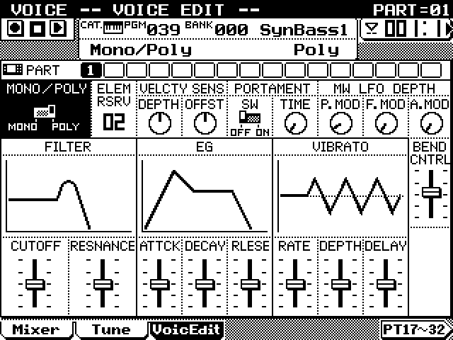

# qy700-dumpscreen



Capture pixel-perfect screenshots of a **Yamaha QY700** sequencer over MIDI.

The QY700 has an undocumented screen-dump feature, probably a leftover from development (it may have been used to capture screens for the manual). Once it's switched on at power-up, the QY700 sends its whole 320×240 LCD as SysEx whenever it receives a particular request message. `qy700_dumpscreen.py` sends that request, receives the reply and saves it as a PNG.

## Requirements

- Python 3
- [python-rtmidi](https://pypi.org/project/python-rtmidi/):

  ```
  pip3 install python-rtmidi
  ```

- A MIDI interface connected **both ways**: computer MIDI OUT → QY700 MIDI IN, and QY700 MIDI OUT → computer MIDI IN.

Tested on macOS. It should also run on Windows and Linux.

## Enabling screen-dump mode on the QY700

The feature is switched on by holding three buttons while powering on:

1. Switch the QY700 off.
2. Hold **[OCT DOWN] + [OCT UP] + the lowest key on the mini keyboard (E2)**.
3. Switch the QY700 on and keep holding for a couple of seconds while it boots.

Nothing visible changes; the QY700 boots as normal, but will now answer screen-dump requests until it is switched off.

> ⚠️ **Be careful:** [OCT DOWN] + [OCT UP] + **F#2** (the first black key, right next to E2) erases the QY700's internal memory and loads the factory settings. Save your songs and patterns to floppy before experimenting.

## Usage

```
python3 qy700_dumpscreen.py
```

1. The tool reminds you how to connect the QY700 and switch screen-dump mode on.
2. Choose your MIDI IN and MIDI OUT ports from the lists.
3. Navigate to the screen you want on the QY700, then press **SPACE** in the terminal.

The request is sent, a progress bar is shown while the reply arrives (about 6.3 seconds, as the dump is 19 KB of SysEx at MIDI speed), and the picture is saved as `qy700_yymmdd_hhmmss.png`.

| Key | Action |
|---|---|
| `SPACE` | Capture the screen |
| `1` / `2` / `3` | Set the PNG scale: 1x (320×240), 2x (640×480), 3x (960×720). The selected scale is highlighted. |
| `Q` / `Esc` | Quit |

### Command-line options

| Option | Description |
|---|---|
| `--in N` / `--out N` | Choose the MIDI ports by number and skip the menus |
| `--scale 1\|2\|3` | Starting PNG scale (default 1) |
| `--timeout S` | Seconds to wait for a reply (default 12) |
| `--syx` | Also save the raw SysEx reply next to the PNG |
| `--dir PATH` | Folder to save captures in (default: current folder) |

## Troubleshooting

If the tool reports **No complete reply from the QY700**:

- **Screen-dump mode isn't on.** Power-cycle the QY700 while holding [OCT DOWN] + [OCT UP] + E2. There are two pairs of octave buttons in the firmware's button list; if one pair doesn't work, try the other.
- **Wrong ports or a missing cable.** The request has to reach the QY700's MIDI IN and the reply has to come back from its MIDI OUT.
- **SysEx is filtered.** Check UTILITY → MIDI Filter on the QY700, and any SysEx filtering in your MIDI interface's driver or software.

On macOS, python-rtmidi only passes on a SysEx message once all of it has arrived. That's why the progress bar is labelled *estimated*: it's timed against the usual transfer length rather than counting bytes. If your MIDI driver delivers the SysEx in pieces, the bar shows the real byte count instead.

## How it works

The feature was found by disassembling the QY700 v1.10 firmware (Hitachi SH-1 CPU).

- **Request:** `F0 43 10 18 5A 01 F7`
- **Reply:** `F0 43 30`, then 19,200 data bytes, then `F7` (19,204 bytes in total). Each byte of the 9,600-byte screen memory (40 bytes per row × 240 rows, leftmost pixel in the top bit) is inverted and sent as two 4-bit values, high half first.
- **Enabling it:** at power-on the firmware reads one row of the front-panel button grid. If exactly OCT DOWN, OCT UP and E2 are held, it sets the flag that allows screen dumps (routine around `0x0A001034` in the program ROM). The screen-dump routine itself is at `0x0A05AF28`.

## Disclaimer

This uses an undocumented feature, and isn't affiliated with or endorsed by Yamaha. Use it at your own risk, and back up your data before trying power-on button combinations.
